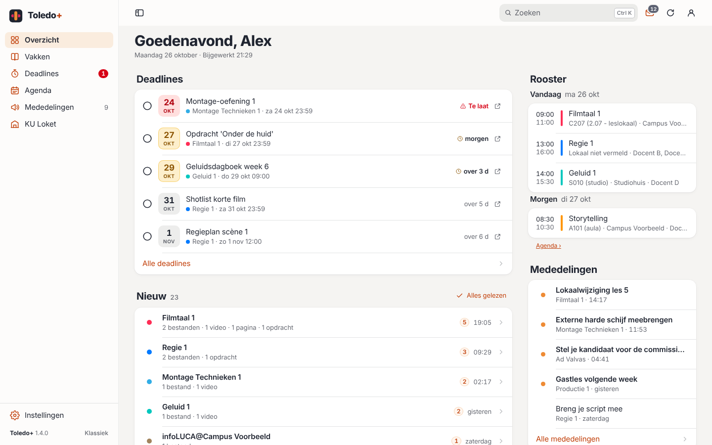
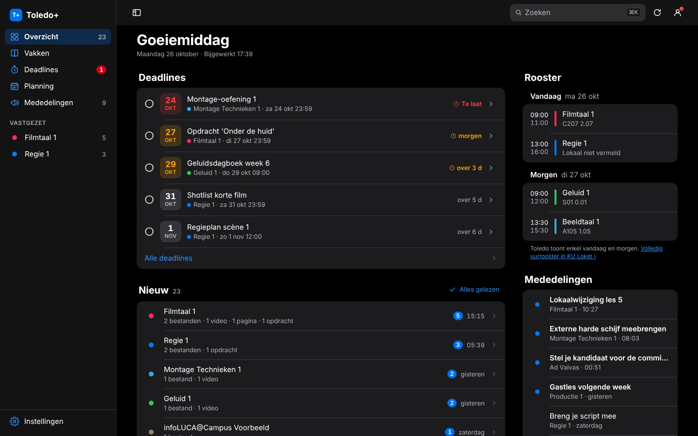
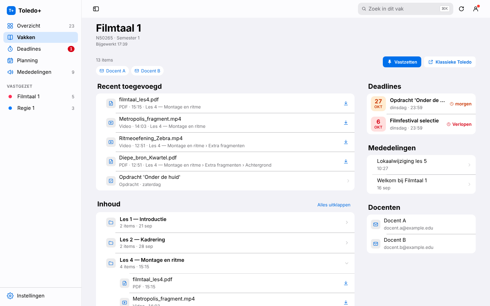
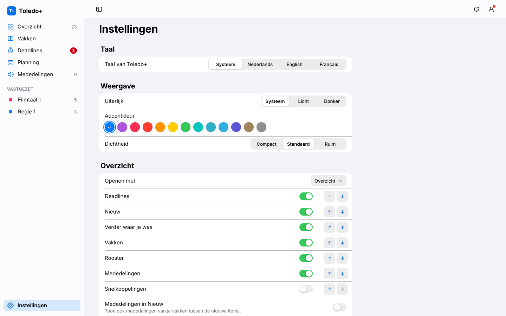
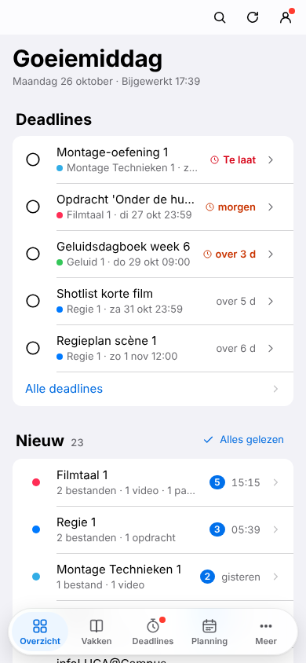

# Toledo+

**Een rustigere, duidelijkere Toledo.** Toledo+ is een gratis browserextensie voor Chrome en Edge die KU Leuven Toledo (het portaal én de Blackboard Ultra-vakpagina's) in één overzichtelijke app giet: deadlines eerst, één compacte feed met wat er nieuw is, en elke vakpagina in dezelfde vorm.

> **Onofficieel.** Toledo+ is een onafhankelijk studentenproject en is niet verbonden aan KU Leuven, LUCA School of Arts of Blackboard/Anthology. Je gebruikt gewoon je eigen Toledo-sessie.

🇬🇧 [Read this in English](README.en.md)

## Screenshots

|  |  |
|---|---|
|  |  |

<p align="center"></p>

<sub>Screenshots met fictieve gegevens.</sub>

## Wat het doet

- **Overzicht** – deadlines, nieuw sinds je laatste bezoek (compact, per vak), verder waar je gebleven was, je vakken, rooster van vandaag en morgen, mededelingen.
- **Vakken** – alleen de vakken van dit jaar; communities en vorige jaren in het archief. Geef vakken een **bijnaam** en **kleur**, zet ze vast of verberg ze.
- **Vakpagina** – recent toegevoegd, de volledige inhoud als uitklapbare mappen, zoeken door alle mappen, bestanden openen of downloaden met één klik, deadlines, aankondigingen en docenten.
- **Deadlines** – Toledo-deadlines + Ultra-kalender + je eigen deadlines in één lijst; afvinken; exporteren naar je agenda (.ics) met herinnering.
- **Planning** en **Mededelingen** (aankondigingen en Ad Valvas, met filters).
- **Gelezen = gelezen in Toledo**: wat je in Toledo+ als gelezen markeert, staat ook in Toledo als gelezen (uit te zetten).
- **Nederlands, English, Français**; licht/donker; accentkleur; dichtheid; secties aan/uit en herschikken.
- **⌘K** (of **/**) zoekt overal: vakken, deadlines, mededelingen én **documenten in al je vakken** (een lokale index, nooit gedeeld). ⌘↵ downloadt meteen; mappen en opdrachten openen in hun vak.
- Inklapbare zijbalk: met **⌘\\** wordt hij een smalle **iconenbalk**. Werkt op laptop én smartphonebreedte (tabbalk onderaan).
- **Klassieke Toledo** is altijd één klik weg (accountmenu); de knop *Toledo+* zet het weer aan.

## Installeren

Toledo+ staat (nog) niet in de Chrome Web Store. Installeren duurt 1 minuut:

1. Download **`toledo-plus-<versie>.zip`** van de [laatste release](https://github.com/joennespreuwers/toledo-plus/releases/latest).
2. Pak het zip-bestand uit naar een vaste plek (bv. `Documenten/Toledo+`). Verwijder die map later niet: de browser laadt de extensie van daaruit.
3. Open de extensiepagina:
   - **Chrome:** `chrome://extensions`
   - **Edge:** `edge://extensions`
4. Zet **Ontwikkelaarsmodus** aan (rechtsboven in Chrome, links onderaan in Edge).
5. Klik **Uitgepakte extensie laden** en kies de uitgepakte map (de map met `manifest.json`).
6. Open [toledo.kuleuven.be/portal](https://toledo.kuleuven.be/portal) en log in zoals altijd.

> Chrome kan bij het opstarten melden dat er ontwikkelaarsextensies actief zijn – dat is normaal voor extensies buiten de Web Store.

### Updaten

1. Download de nieuwe zip van [Releases](https://github.com/joennespreuwers/toledo-plus/releases).
2. Vervang de inhoud van je Toledo+-map door de nieuwe bestanden.
3. Ga naar `chrome://extensions` (of `edge://extensions`) en klik op ↻ (herladen) bij Toledo+.
4. Herlaad je Toledo-tabblad. Je instellingen blijven bewaard.

Je versie zie je in **Instellingen → Over**. Volg de repository (*Watch → Custom → Releases*) om een melding te krijgen bij nieuwe versies.

## Privacy

Toledo+ leest alleen wat Toledo jou zelf al toont, via je eigen sessie op `toledo.kuleuven.be` en `ultra.edu.kuleuven.cloud`. Instellingen staan in de opslag van je browser. **Geen analytics, geen trackers, geen eigen servers, geen andere websites.** Details: [PRIVACY.md](PRIVACY.md).

## Problemen of ideeën?

- 🐞 **Bug:** [meld een bug](https://github.com/joennespreuwers/toledo-plus/issues/new?template=bug_report.yml)
- ✨ **Idee:** [stel iets voor](https://github.com/joennespreuwers/toledo-plus/issues/new?template=feature_request.yml)
- 💬 **Vraag:** [Discussions](https://github.com/joennespreuwers/toledo-plus/discussions)
- 🔒 **Beveiliging:** zie [SECURITY.md](SECURITY.md)

Zet **geen echte persoonsgegevens** (namen, e-mails, r-nummer, vakinhoud) in issues of screenshots. Issues worden twee keer per week bekeken.

## Ontwikkelen

```bash
git clone https://github.com/joennespreuwers/toledo-plus.git && cd toledo-plus
npm install && npx playwright install chromium
npm test            # unit + e2e (headless Chromium met de extensie en een gemockte Toledo)
npm run pack        # dist/toledo-plus-<versie>.zip
```

Geen build-stap: laad de map rechtstreeks via *Uitgepakte extensie laden*. Lees eerst [`docs/ARCHITECTURE.md`](docs/ARCHITECTURE.md) en [`docs/DESIGN.md`](docs/DESIGN.md).

### Projectstructuur

```
manifest.json        MV3-manifest
background.js        cross-origin fetch-relay (portaal ↔ Ultra)
page.css             verbergt de originele pagina, "Toledo+"-knop in klassieke modus
ui.css               design tokens + gedeelde componenten (in de shadow root)
src/core/            util, i18n, settings, net, data, index (⌘K-index), ui, shell, palette (⌘K)
src/i18n/            vertalingen (nl/en/fr) per view
src/views/           overview, courses, course, deadlines, planning, announcements, settings (+ .css)
src/boot.js          start alles op beide origins
tests/               unit (node:test) + e2e (Playwright) met synthetische fixtures
scripts/             pack.mjs (zip), setup-github.sh, run-tests.mjs
docs/                architectuur en design
legacy/              v0.2-prototype (alleen ter referentie)
```

## Bijdragen

Graag! Lees [CONTRIBUTING.md](CONTRIBUTING.md) en de [gedragscode](CODE_OF_CONDUCT.md). AI-agents: [AGENTS.md](AGENTS.md).

## Licentie

[MIT](LICENSE) © 2026 Joenne Spreuwers
